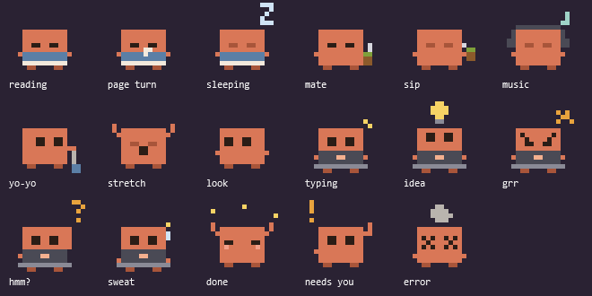

# Clawd Buddy

A tiny pixel companion for Claude Code on Windows. It sits in the bottom-right corner of your screen and tells you what your sessions are doing while you work on something else.



| State | When | What it does |
|---|---|---|
| Idle | No session needs you | Reads a book, blinks and turns pages. Every 20-45 s it does something at random: drinks mate, listens to music, plays with a yo-yo, stretches, looks around, blows bubble gum, juggles, plays a handheld console, gets a visit from a cat, dances or meditates. After 10 idle minutes it falls asleep |
| Working | You sent a prompt | Types on a laptop with the running tool floating over its head: a pencil for edits, a terminal for shell commands, a magnifier for reads and searches, a globe for web requests. Every 6-15 s it has an idea (light bulb), grumbles, scratches its head, sweats, types at full speed, looks up thinking, squashes a bug crawling on the laptop, searches with a magnifier, celebrates, facepalms, watches a loading bar or takes a mate break |
| Compacting | The conversation is being compacted | Squashes a stack of papers on its head |
| Done | Claude finished its turn | Jumps with confetti, shows a green bubble with how long the turn took and the first line of the answer, chimes |
| Needs you | Permission or input required | Waves under a blinking "!", shows an amber bubble, chimes |
| Error | The turn failed (rate limit, API error...) | Shakes with X eyes and smoke, red bubble, alert sound |

- **Left click**: dismiss the bubble and jump to the terminal window of that session.
- **Drag**: move it. It keeps its bottom-right corner when the bubble appears.
- **Right click**: mute sounds or quit.
- **Double click**: pet it. It hops with hearts.
- **Hover**: list of active sessions, their state and running subagents.

Every running subagent shows up as a mini Clawd hopping around it (up to three). On special dates a prop stands at its feet, and the hover list names the day:

| Date | Day | Prop |
|---|---|---|
| Mar 24 | Día de la Memoria | white scarf |
| Apr 2, May 25, Jun 20, Jul 9, Aug 17, Nov 20 | Malvinas, Revolución de Mayo, Bandera, Independencia, San Martín, Soberanía | flag |
| Jul 20 | Día del Amigo | heart |
| Sep 11 | Día del Maestro | apple |
| Day 256 (Sep 13, Sep 12 in leap years) | Día del Programador | monitor |
| Sep 21 | Primavera y Estudiante | flower |
| Oct 24-31 | Halloween | pumpkin |
| Nov 10, Nov 30 | Día de la Tradición, Día del Mate | mate |
| Dec 18 | 2022 World Cup final | trophy |
| Dec 8 to Jan 6 | Christmas (the tree goes up on Dec 8) | tree |
| Every 29th | Ñoquis del 29 | gnocchi |

Dates live in `$SpecialDays` in `lib/state.ps1` and their names in `lib/strings.json`.

With several sessions open, the avatar shows the most urgent one: error, then needs you, then done, then working. The bubble names the project, and the hover list shows every session. Clicking brings the terminal window forward; picking the exact Windows Terminal tab is not possible from outside, so the project name tells you which tab it is.

## Language

Bubbles and menus follow the Windows display language (English and Spanish included). To force one, set `CLAWD_BUDDY_LANG` (for example `es` or `en`) and restart the avatar. Translations live in `lib/strings.json`; add a language by copying the `en` block. Texts sent by Claude Code itself, such as notification messages, are shown as received.

## Requirements

- Windows 10/11 with Windows PowerShell 5.1 (built in). No Node, Python or Electron.
- Claude Code with hook support (`PermissionRequest`, `StopFailure`, async hooks).

## Install

```powershell
powershell -NoProfile -ExecutionPolicy Bypass -File .\install.ps1
```

The installer:

1. Backs up `~/.claude/settings.json` to `settings.json.clawd-buddy-<timestamp>.bak`.
2. Adds async hooks tagged `clawd-buddy` for `SessionStart`, `SessionEnd`, `UserPromptSubmit`, `Stop`, `StopFailure`, `PermissionRequest`, `Notification`, `PreToolUse`, `SubagentStart`, `SubagentStop`, `PreCompact` and `PostCompact`. Your other hooks are left untouched, and running it again does not duplicate entries.
3. Starts the avatar.

Hooks load when a session starts, so open a new Claude Code session afterwards. The avatar also starts automatically with each new session.

Keep the repository where it is: the hooks point to `hook.ps1` by absolute path. If you move it, run `install.ps1` again.

## Uninstall

```powershell
powershell -NoProfile -ExecutionPolicy Bypass -File .\uninstall.ps1
```

Removes only the `clawd-buddy` hooks and stops the avatar.

## How it works

- `hook.ps1` receives each hook event on stdin and writes one small JSON file per session to `%LOCALAPPDATA%\clawd-buddy\sessions`. It never prints anything and always exits 0, so it cannot break Claude Code. Errors go to `%LOCALAPPDATA%\clawd-buddy\hook.log`.
- `avatar.ps1` is a transparent WPF window that polls those files and animates the sprite.
- `PermissionRequest` signals "needs you" immediately; `Notification` is only a fallback because it arrives late and repeats idle reminders.
- No hook fires when you grant a permission, so the avatar treats new transcript output as "working again".
- A closed terminal sends no `SessionEnd`, so a working session with no activity for 15 minutes goes back to idle.
- `PreToolUse` starts one PowerShell process per tool call. It is async, so Claude Code never waits for it, but it costs a little CPU on busy sessions. To drop the tool icons, remove the `clawd-buddy` entry under `PreToolUse` in `settings.json`.
- Tool, subagent and compaction activity go to side files next to the session file (`<id>.tool`, `<id>.agents\`, `<id>.compact`). Those hooks run in parallel, so sharing the main file would lose updates. Subagent marks expire after 30 minutes in case a `SubagentStop` never arrives.

## Tests

```powershell
powershell -NoProfile -ExecutionPolicy Bypass -File .\tests\run.ps1
```

Drawings live in `lib/sprites.json` as plain data: each letter is one pixel colored by the palette, and a dot is transparent. To regenerate the scene sheet after editing them:

```powershell
powershell -NoProfile -ExecutionPolicy Bypass -Sta -File .\tools\preview.ps1
```

## Notes

- Script files are ASCII-only on purpose: Windows PowerShell 5.1 misreads UTF-8 files without a BOM. Translated text lives in `lib/strings.json`, which is read explicitly as UTF-8.
- The pixel character is an original design in Claude's colors, inspired by the cozy lo-fi pixel style of Claude FM.
